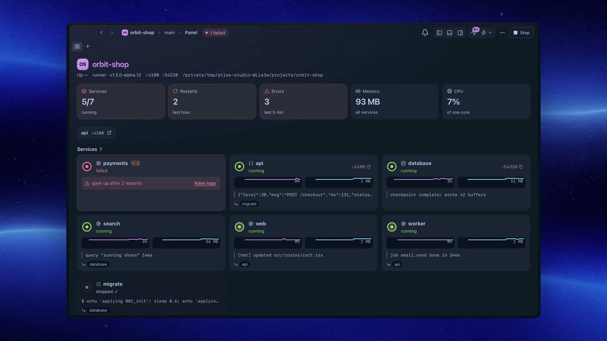

<p align="center">
  
</p>

<h1 align="center">Atlas</h1>

<p align="center">
  <strong>The developer platform for everyone.</strong><br>
  <sub>one <code>atlas.yaml</code> runs your whole stack. a native workspace runs your agents. your platform team is a YAML file.</sub>
</p>

> [!WARNING]
> **Atlas is in alpha.** It works and we use it every day, but expect bugs and breaking changes between releases. Please [open an issue](https://github.com/codeatlasdev/atlas/issues/new) when something breaks. Releases come in Stable, Beta and Alpha channels: see [docs/versioning.md](docs/versioning.md).

<p align="center">
  <a href="#contributing-security-license"></a>
  
  
  
  <a href="CODE_OF_CONDUCT.md"></a>
</p>

<p align="center">
  <a href="https://atlas.codeatlas.com.br">website</a> ·
  <a href="docs/introduction.md">docs</a> ·
  <a href="CHANGELOG.md">changelog</a> ·
  <a href="CONTRIBUTING.md">contributing</a>
</p>

<p align="center">
  <a href="https://atlas.codeatlas.com.br">
    
  </a>
</p>

<p align="center"><sub>↑ the 78-second film, real footage of the real app. <a href="https://atlas.codeatlas.com.br">watch it on the website</a>.</sub></p>

## what it is

Atlas is a **developer platform** that doesn't need a platform team. The thing big companies build with a dozen tools and a quarter of work (a paved road from `git clone` to a running, observable stack) is one file in your repo and one binary on your machine.

- **Stack orchestration.** `atlas.yaml` describes infra, services, dependency order, health checks, restarts and actions. `atlas dev` boots it and keeps it honest.
- **A desktop workspace.** Atlas Desktop is a native app (macOS and Linux today, Windows coming soon): a project per space, a git worktree per task, a GPU terminal, diff review, PRs and an embedded browser.
- **Agents in the loop.** omp, Claude Code and Codex run in parallel worktrees, with live "working / needs you / done" status.
- **MCP for your agents.** `atlas mcp` lets an agent read status and logs, restart a service and wait until it is healthy while you keep coding.

Same live state behind all of it: the TUI, the desktop app and the MCP server never disagree.

<p align="center">
  
</p>

<p align="center"><sub>↑ real recording, not a mockup. regenerate with <code>vhs demo/demo.tape</code> · demo stack in <a href="demo/atlas.yaml"><code>demo/atlas.yaml</code></a></sub></p>

## install

```bash
curl -fsSL https://atlas.codeatlas.com.br/install.sh | sh
```

Downloads the newest release of the default update channel (the newest alpha while Atlas is in alpha; [pick another](docs/installation.md#install-a-beta-or-alpha)), verifies its SHA-256, puts `atlas` in `~/.atlas/bin` and wires your `PATH` and the bundled agent skills. Needs only `curl`: no GitHub login, no `sudo`. Prefer a `.dmg`? Grab it from the [latest release](https://github.com/codeatlasdev/atlas/releases/latest). Want the installer to also offer agent setup (omp, Claude Code, Codex)? Use [`scripts/bootstrap.sh`](scripts/bootstrap.sh). Manual install, building from source and uninstalling → [docs/installation.md](docs/installation.md).

```bash
atlas update    # checks every 6h; `atlas dev` offers to update before starting (Y/n)
atlas desktop   # installs and opens Atlas Desktop (macOS on Apple silicon, Linux x86_64)
```

Atlas is for everyone; it ships platform by platform. Available now: macOS on Apple silicon and Linux x86_64, with [.deb, .rpm, Arch (`pacman -U`) and AppImage packages](docs/installation.md#linux-packages) on every release. Coming soon: Intel Macs, Linux on ARM and Windows (see the [download page](https://atlas.codeatlas.com.br/download/)). Details in the [FAQ](docs/faq.md).

## 60-second quickstart

```bash
atlas init      # scaffold atlas.yaml
atlas dev       # send it  (? = keys, q = quit)
```

You `cd` into a monorepo and run **`atlas dev`**. Postgres + Redis come up in Docker, migrations run first, the API waits until it's actually ready, the web app waits for the API, crashy stuff restarts with backoff, every log lands in a searchable TUI *and* on disk. That's the whole paved road.

```yaml
# yaml-language-server: $schema=./.atlas.schema.json   ← `atlas config schema > .atlas.schema.json`
name: myapp
env_files: [.env]

infra:
  compose_file: docker-compose.yml

services:
  migrate:
    command: bun run db:migrate
    oneshot: true
  api:
    command: bun run dev:api
    port: 3000
    health: http://localhost:3000/health
    depends_on: { migrate: completed_successfully }
    restart: on_failure
    open_key: a
  web:
    command: bun run dev:web
    port: 3001
    depends_on: { api: healthy }

actions:
  - key: u
    label: Reset local DB
    command: bun run db:reset
    confirm: "Wipes your local DB. Sure?"
    pause_services: [api]
```

Other modes:

| command | what it does |
|---|---|
| `atlas dev web` / `atlas dev --profile backend` | start only those services + what they `depends_on` (`--no-deps` skips that); the rest show `off` and start by hand |
| `atlas dev --detach` | start the services in a background runner and return; `atlas dev` attaches the TUI (`D` detaches, services keep running), `atlas down` stops it |
| `atlas dev --headless` | no TUI, logs to stdout, still serves MCP control (attachable too) |
| `atlas dev --ci` | boots, waits for stable, prints JSON, exits 0/1 |
| `atlas dev --status` | is it running (and `mode: runner\|tui`, attached clients)? exit 0 yes / 3 no |
| `atlas down` | stop the running atlas gracefully (runner or TUI) |
| `atlas config check` | validate config, show every error at once |

## features

### stack orchestration (CLI + TUI)

- 🧠 **knows your dependency graph.** `depends_on: { migrate: completed_successfully, api: healthy }`, plus `started` and `log_ready` (regex on a log line). No more `sleep 10 && bun dev`.
- 🔁 **self-healing.** `restart: on_failure`, exponential backoff 1s → 30s, gives up loudly after `max_restarts`. Crash loops never show a fake green dot.
- ✅ **typo-proof config.** `services.web.helth: unknown field (did you mean 'health'?)` before your terminal goes raw. JSON Schema for editor autocomplete.
- 🖱️ **mouse that works everywhere.** tabs, sidebar rows, `⋯` menus, footer hints, modal buttons, palette items, scrollbar drag, all from one render-time click map, so it never drifts.
- 📱 **mobile dev built in.** device picker for iOS sims / Android devices, build phase tracking, LAN-vs-loopback dev host injected for Tauri.
- 🔐 **ssh tunnels that behave.** keepalive, reconnect on Wi-Fi switch, verified reuse across runs, never kills by port.
- 🧼 **leaves no mess.** exact-PID orphan cleanup, singleton lock, terminal always restored (panic, SIGHUP, Ctrl+Z included).
- 🚢 **deploy.** atomic, health-gated releases with rollback → [docs/deploy.md](docs/deploy.md).

### logs

- 🔎 **logs you can actually read.** exact wrap with hanging indent, find with highlight + `n/N`, regex + smartcase, filter vs find, level and time-range filters, JSON (pino/bunyan) compaction, jump between errors, clickable URLs and `path:line`.
- 🗂️ **per-service buffers** so one chatty service can't nuke the rest, and every line also lands in `.logs/` on disk.

### Atlas Desktop

- 🪟 **one window for many coding agents in parallel.** a project per space, a git worktree per task (with its own port offset, so each worktree runs its own stack), persistent terminals that survive quitting the app.
- 🔍 **review without leaving.** diff review with notes sent back to the agent, PRs and checks via `gh`, an embedded browser with Design Mode, worktrees on SSH hosts.
- 🎛️ **yours to shape.** Zed-style docks, command palette, rebindable keys and Zed themes.
- 🎨 **themes.** Atlas Dark and Light (a blue, Tokyo Night based pair) are the defaults, next to Dracula and Alucard by [Zeno Rocha](https://github.com/zenorocha) and [Luxonauta](https://github.com/luxonauta) (MIT), and One; import Ghostty, iTerm, VS Code, Alacritty or Base16 themes, or your own [Dracula Pro](https://draculatheme.com/pro) purchase from a zip.

### GPU terminal

- ⚡ **a terminal that keeps up.** native Metal renderer (wgpu): 120 Hz, sub-millisecond frames, Kitty graphics + sixel images, color emoji, ligatures, shell integration (jump between prompts, exit codes, cwd), regex search, Kitty keyboard.

### agents & MCP

- 🤖 **agent-native.** `atlas mcp` is a stdio MCP server: status, logs, log search, restart/stop/start, run actions (with a confirm gate), wait-until-ready. `atlas dev --status` / `--ci` for scripts.
- 👀 **live agent status.** omp, Claude Code and Codex show "working / needs you / done" in Desktop, with notifications. `atlas wt` / `atlas term` let agents drive the app back.

## plug your agent in

```bash
atlas setup                        # detects omp / claude / codex and shows what to run
atlas setup claude-code            # dry run: shows exactly what it would change
atlas setup claude-code --apply    # MCP server + skills + hooks for Claude Code
atlas setup codex --apply          # same for Codex (then trust the hooks once in /hooks)
atlas setup omp --apply            # one plugin for OMP: MCP server, hook, rule, subagent, skills
```

Each adds the `atlas` MCP server to the agent's config, makes the Atlas skills available to it, and registers hooks that hand the agent `atlas dev --status` at session start and stop it from launching the interactive TUI. It merges with your existing config (comments and other entries kept), is idempotent, and `--uninstall` removes only what it added. Restart the agent, then ask *"why is api failing?"* or *"restart web and wait until it's ready"*.

Cursor and other MCP clients → manual entry in [docs/mcp.md](docs/mcp.md); details and troubleshooting → [docs/agents.md](docs/agents.md).

## keys you'll actually use

| key | does |
|---|---|
| `0-9` / `Tab` | jump between service tabs |
| `/` then `n` `N` | find in logs (`Tab` = filter mode, `Ctrl+R` = regex) |
| `v` / `V` | level filter (all → warn+ → error) / time range |
| `f` / `G` | follow on/off / jump to newest |
| `J` `W` `T` | JSON compact · wrap · timestamps |
| `]e` `[e` | next / previous error line |
| `:` | command palette (fuzzy, recents first) |
| `m` | service menu (restart / stop / start) |
| `z` | zoom logs (hide sidebar) |
| `M` | release the mouse so you can select text |
| `D` | attached to a runner: detach, services keep running |
| `?` | everything else |

Full list → [docs/tui.md](docs/tui.md).

## vs the competition

Honest table. ✅ = built in · 🟡 = partial / via something else · ❌ = no. Based on each project's own docs, checked Oct 2026.

| | **Atlas** | [process-compose](https://github.com/F1bonacc1/process-compose) | [mprocs / dekit](https://github.com/pvolok/mprocs) | [Overmind](https://github.com/DarthSim/overmind) | [Tilt](https://tilt.dev) | [Turborepo TUI](https://turborepo.com) |
|---|:-:|:-:|:-:|:-:|:-:|:-:|
| Single YAML for the whole stack | ✅ | ✅ | ✅ | 🟡 Procfile | 🟡 Starlark | 🟡 tasks |
| Docker compose infra in the same run | ✅ | ❌ | ❌ | ❌ | ✅ | ❌ |
| Dependency conditions (healthy / completed / log ready) | ✅ | ✅ | 🟡 ready log | ❌ | ✅ | 🟡 task graph |
| Restart policy + backoff | ✅ | ✅ | ✅ | 🟡 `-r` | ❌ | ❌ |
| Log find with highlight + `n/N` | ✅ | ✅ | ❌ | ❌ | 🟡 web | ❌ |
| JSON log pretty-print | ✅ | ✅ | ❌ | ❌ | ❌ | ❌ |
| Per-tab activity + error badges | ✅ | 🟡 activity | ❌ | ❌ | ✅ web | ❌ |
| Full mouse support | ✅ | 🟡 | 🟡 | ❌ | ✅ web | 🟡 |
| Logs persisted to disk w/ rotation | ✅ | ✅ | ❌ | ❌ | ❌ | 🟡 `--log-file` |
| MCP server for AI agents | ✅ | ✅ | ❌ | ❌ | ❌ | 🟡 AGENTS.md |
| Config validation w/ "did you mean" | ✅ | ❌ | ❌ | ❌ | ❌ | ❌ |
| Mobile device picker (iOS/Android) | ✅ | ❌ | ❌ | ❌ | ❌ | ❌ |
| Managed SSH tunnel | ✅ | ❌ | ❌ | ❌ | ❌ | ❌ |
| Actions with confirm + pause services | ✅ | ❌ | ❌ | ❌ | 🟡 buttons | ❌ |
| Detach + reattach later | ✅ `--detach` | ✅ | ✅ dekit | ✅ tmux | ✅ | ❌ |
| Native desktop app | ✅ macOS, Linux | ❌ | ❌ | ❌ | ❌ | ❌ |
| File-watch restart | ❌ | ✅ | ❌ | ❌ | ✅ | ✅ `watch` |
| Replica scaling | ❌ | ✅ | ❌ | ✅ | ❌ | ❌ |
| Windows | ❌ | ✅ | ✅ | ❌ | ✅ | ✅ |

**no cap:** process-compose is the closest all-rounder and still wins on replicas and Windows. Tilt owns the k8s world. Atlas goes deepest on a bun/TS monorepo with Docker infra, mobile targets and AI agents in the loop, and is growing from there.

## docs

Also published at [atlas.codeatlas.com.br/docs](https://atlas.codeatlas.com.br/docs/).

| | |
|---|---|
| 🚀 [Getting started](docs/getting-started.md) | install, first `atlas.yaml`, first run |
| 📦 [Installation](docs/installation.md) | release, update, build from source, uninstall |
| 🧩 [Concepts](docs/concepts.md) | projects, spaces, worktrees, services, actions, runner, hostd |
| ⚙️ [Configuration](docs/configuration.md) | every field, `atlas.local.yaml`, validation, JSON Schema |
| 🖥️ [TUI](docs/tui.md) | layout, keys, mouse, log viewer, sessions |
| 🪟 [Desktop](docs/desktop.md) | worktrees, agents, review, browser, SSH hosts, keys |
| ⚡ [GPU terminal](docs/terminal.md) | renderer, images, shell integration, performance |
| 📜 [Logs](docs/logs.md) | collection, storage, search, bursts |
| 🧰 [CLI](docs/cli.md) | commands, flags, exit codes |
| 🤖 [Agent setup](docs/agents.md) | `atlas setup omp\|claude-code\|codex`: MCP + skills + hooks |
| 🔌 [MCP](docs/mcp.md) | tool reference + manual client setup |
| 🧬 [Runtime](docs/runtime.md) | startup order, restarts, shutdown, cleanup, `.logs/` |
| 🚢 [Deploy](docs/deploy.md) | atomic, health-gated releases with rollback |
| 🩺 [Troubleshooting](docs/troubleshooting.md) · [FAQ](docs/faq.md) | when something is off |
| 🏗️ [Architecture](docs/architecture.md) | crates, processes, sockets |

## hacking on Atlas

```bash
scripts/setup.sh           # rustup, bun, frontend deps, cargo-tauri, cargo-deny
cargo build -p atlas-cli   # the real binary (atlas-tui alone is just a lib)
bun run check              # fmt + clippy -D warnings + tests + deny + skills + desktop — same as CI
atlas link                 # point your installed atlas at the debug build
bun run desktop:dev        # Atlas Desktop with hot reload
```

```
crates/
  atlas-core/    shared types, paths, GitHub release client, crash reports
  atlas-tui/     TUI, runtime, config, MCP server
  atlas-host/    hostd: terminals (PTY/pipe), exec, fs for Atlas Desktop
  atlas-skills/  bundled agent skills + installer
  atlas-term/    GPU terminal: VT, wgpu/Metal renderer, fonts, images
  atlas-desktop/ Atlas Desktop (Tauri 2)
  atlas-cli/     the `atlas` binary
apps/desktop/  Atlas Desktop UI (SvelteKit + @codeatlasdev/ui)
site/          the website (Astro + Svelte); renders docs/ as the docs section
docs/  skills/  scripts/
```

Rust 1.99 (pinned in `rust-toolchain.toml`). GitHub Actions are manual-only: CI and releases run locally through [`act`](https://github.com/nektos/act).

## contributing, security, license

- **Contributing:** read [CONTRIBUTING.md](CONTRIBUTING.md) before opening a pull request. Be kind: [Code of Conduct](CODE_OF_CONDUCT.md).
- **Security:** report vulnerabilities privately via [SECURITY.md](SECURITY.md), not in public issues.
- **Releases:** maintainers, see [docs/release.md](docs/release.md).
- **License:** [MIT](LICENSE-MIT) or [Apache-2.0](LICENSE-APACHE), at your option. Third-party notices → [THIRD_PARTY_NOTICES.md](THIRD_PARTY_NOTICES.md).

<p align="center"><sub>made with too much coffee by CodeAtlas · MIT or Apache-2.0</sub></p>
