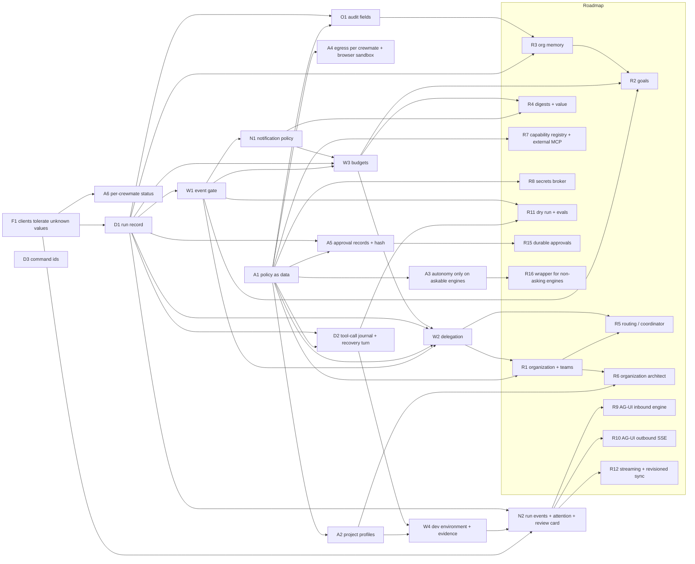

# Dependency graph

Which capability must exist before which. IDs are the recommendations in [recommended-architecture.md](recommended-architecture.md). An arrow `X --> Y` means "Y needs X". Solid nodes are in the `1.5.0-alpha.29` milestone; the R nodes are on the roadmap.

## Why each edge exists

| Edge | Reason |
|---|---|
| F1 before D1, A6, N2 | They add fields and enum values that old desktop and mobile builds read. A strict decoder would crash or hide the board. |
| A1 before A2 | A project profile is a policy file plus a descriptive file; without a policy engine the profile is only text in the prompt. |
| A1 before A3 | "Automatic origin" is a policy input; the refusal of unattended engines is a policy decision. |
| A1 before A4 | Egress rules per crewmate are read from the same policy files. |
| A1 and D1 before A5 | An approval record names the task (D1) and the rule that held it (A1). |
| A1 and D1 before D2 | The journal is per task (D1); `external` classification uses policy labels (A1). |
| D1 before W1 | The gate writes taint and lineage into the task it creates. |
| W1 before W2, W3, N1 | Delegation, budgets and the quiet outcome are all decisions made at the gate. |
| W3 before W2 | A delegated task spends from a carve of its parent's budget; without budgets, delegation has no spend bound. |
| N1 before W3 | A budget stop must reach a person; the notification policy is where that is guaranteed. |
| A2 and D2 before W4 | The services a crewmate may start come from the profile; the review evidence (external calls, PR) comes from the journal. |
| W4 before N2 | The review card shows the review object W4 records. |
| W2 before R1, R5 | Teams and routing are only useful once one crewmate can hand work to another. |
| N2 before R9, R10, R12 | AG-UI and streaming are projections of typed run events; without them there is nothing to project. |

## Critical path

`F1 -> D1 -> W1 -> N1 -> W3 -> W2` is the longest chain inside the milestone. `A1 -> A2 -> W4 -> N2` runs in parallel with it after A1. A1 and F1 have no dependencies and start first; D3, A6 and O1 are short and can run beside anything once their single parent lands.
