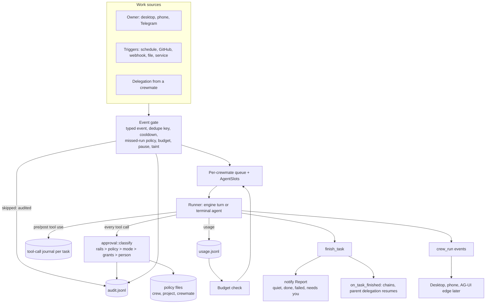

# Recommended architecture: the smallest evolution of Atlas Crew toward autonomous organizations

Baseline: `main` at `72b47fc3` (2026-11-20). Evidence: [current-state.md](current-state.md), [capability-matrix.md](capability-matrix.md) and the raw reports in [research/](research/). Paths are repo-relative; `crew/` means `crates/atlas-host/src/crew/`. `[INFERENCE]` marks what was derived, not observed.

## 1. The position in one paragraph

Atlas Crew already has the hard part of an agent operating system: a host daemon (hostd) that owns every agent process, decides every tool call of the engines that can ask (`crew/approval.rs:665`, order: rails, mode, task grants, person), isolates each crewmate as its own Linux user with its own cgroup and nftables chain (`crew/spawn/`), persists tasks in an append-only log (`crew/store/tasklog.rs`), recovers interrupted work with a cap (`crew/runner/recover.rs`), audits decisions (`crew/audit/`), and reaches people on desktop, phone and Telegram. What it lacks is not a new subsystem. It lacks **five things around the existing task funnel**: policy that is data instead of three mode labels, a run record that knows its parent and what it already did outside, a gate in front of every automatic start, a way for one crewmate to hand work to another through hostd, and a single place that decides who hears about what. Everything else in the RFC (organization, goals, knowledge, onboarding, interop) builds on those five and can wait.

## 2. Principles (binding for every work item)

1. **hostd stays the only authority.** No decision that grants, spends or reaches outside is taken by a model or a client. Model text is input, never permission (RFC §30). The policy decision point stays `approval::classify`.
2. **No new database, queue or workflow engine.** Every store below is a JSONL or JSON file in the hostd dir, using the helpers that exist (`crew/store/jsonl.rs`, `tasklog.rs`, the delivery-claim pattern of `crew/github/app/webhook.rs`). RFC §27.3.
3. **One task funnel.** Delegation, triage, retries and recovery all create or resume a `Task` through the path every trigger already uses: `Task::new` -> `append_task` -> `runner::enqueue` -> `run_worker` -> `finish_task` -> `triggers::on_task_finished` (`crew/triggers/mod.rs:460-540`).
4. **Additive wire, behind caps.** `PROTO` stays 2 (`protocol.rs:69-77`). Every new command or push gets a cap, a phone scope in `mobile/mod.rs` (`required_scope`, `push_scope`) and a contract fixture written by the real serializer (`UPDATE_FIXTURES=1`).
5. **New configuration lives in new files, never inside `crew.json` or `crewmate.json`.** A rolled-back hostd rewrites those through its own structs and drops unknown fields (research/audit-runtime-authority.md §5, research/audit-organization-work.md §5). Separate files survive a downgrade untouched.
6. **The repository may tighten, only the owner may loosen.** Anything read from a repo (a profile, a skill, `AGENTS.md`) can add restrictions. Loosening a rule needs an owner connection (the `origin_of` check in `approval.rs:941-955`). A pull request must never be able to widen what a crewmate may do (the same reason Monocode keeps a Mono's soul out of repos, research/study-monocode.md §9.6).
7. **Taint travels.** Work that started from a stranger's text (`no_auto`, `crew/triggers/mod.rs:141-170`) keeps that mark in every task derived from it: delegations, retries, chained runs.
8. **Fail closed, visibly.** The existing patterns (unreadable `crew.json` reads as paused, missing isolation helper refuses every task, an unanswered approval is a deny) apply to every new check: an unreadable policy holds, it never allows.
9. **Measured numbers only.** Budgets and reports use what engines report. No invented dollar figures and no "time saved" without a baseline (RFC §22, research/study-monocode.md §11.1-9).

## 3. Target shape

New pieces are the gate, the policy files, the journal, the budget check, `notify` and `crew_run` events. The queue, slots, runner, approval engine, audit, usage log, finish path and chain triggers exist today.

## 4. Recommendations

Each recommendation names: what already exists, what is missing, why it is needed, dependencies, alternatives considered, risks, and acceptance criteria. IDs (A1, D1, W1, ...) are used by [dependency-graph.md](dependency-graph.md) and [implementation-sequence.md](implementation-sequence.md).

### F1. Clients tolerate values they do not know

- **Exists.** Desktop normalizes older servers (`apps/desktop/src/lib/crew/wire.ts:23-39`); mobile reads `kMinHostProto` (`apps/mobile/lib/core/protocol/protocol_version.dart`).
- **Missing.** Nobody has verified that desktop and mobile survive an unknown `TaskState`, `action.kind`, `triggers[].kind.type` or crewmate `state` (research/audit-organization-work.md §5, research/audit-runtime-authority.md §7). Several recommendations below add enum values.
- **Why.** Old phones and desktops talk to new crew servers for weeks after a release. A strict decoder turns an additive server change into a crash or an empty board.
- **Dependencies.** None. It goes first.
- **Alternatives.** Never add enum values (forces every new concept into side objects forever); bump `PROTO` each time (strands old phones behind an update screen).
- **Risks.** Low. A tolerant client can hide a real shape bug; the contract tests below keep that visible.
- **Acceptance.** Contract tests on desktop (bun) and mobile (Flutter) that feed the real Rust fixtures with an extra unknown variant in each of the four sets: the list renders, the unknown item shows a neutral "update Atlas to see this" state, nothing throws. A Rust test produces the fixture (never hand-written JSON, AGENTS.md "Tests").

### A1. Policy as data in front of the permission mode

- **Exists.** `approval::classify` already orders rails, mode, task grants and a person (`crew/approval.rs:69-83`); rails cover protected paths and `no_auto` (`approval.rs:85-110, 347-395`); `destructive()` recognizes `rm -r`, force pushes, `reset --hard`, `DROP TABLE` and more (`approval.rs:112-226`); only owner connections change a mode (`approval.rs:941-955`).
- **Missing.** Policy is three labels (`ask`, `edits`, `bypass`). There is no rule that says "never `bun run deploy` in ac", "hold any `ssh prod-3-codeatlas`", "never `gh pr merge`". `destructive()` gates voice approvals only: in `bypass` an `rm -rf` runs without a question (research/audit-runtime-authority.md §2).
- **Why.** Every target repo forbids things that are ordinary shell commands: pushing to `main` in ac is a production deploy, `db:reset` wipes zelvo's shared Neon database, wi's deploy rolls a single production host (research/dogfood-targets.md §6). Without rules that hostd enforces, the only boundary is the model reading `AGENTS.md`, which the RFC rejects as a security boundary (§30).
- **Shape.**
  - Files owned by hostd, unreadable for writing by crewmate users: `<hostd dir>/crew/policy/crew.json`, `policy/projects/<project key>.json`, `policy/crewmates/<id>.json`.
  - A rule: `{id, label, match: {tool?, command_words?, argv_prefix?, paths?, hosts?}, effect: deny | hold | allow, applies_to: {origin?: owner | automatic | delegated | stranger, engines?}, reason}`.
  - Evaluation in `classify`: rails, then deny rules, then hold rules, then allow rules, then the mode, then task grants, then a person. The most restrictive matching rule wins. With no policy files the result is exactly today's.
  - Defaults shipped with hostd: `destructive()` matches become `hold` in every mode for tasks whose origin is not the owner; `git push` to `main`, `master`, `release/*` and any `--force` is `deny` for automatic and delegated origins; `gh pr merge` and `bun run pr:merge` are `hold`.
  - Editing a policy is an owner command (`crew_policy_get` / `crew_policy_set`, refused for `crewmate:<id>` origins and for phones by default) and writes `config_changed{field: "policy", rule_ids, by}` to the crew audit.
- **Dependencies.** None for the engine. Project profiles (A2) feed it.
- **Alternatives.** (a) Grow the mode enum into the RFC's autonomy levels: still coarse, and every new label is a client enum change. (b) A general policy language (Rego, Cedar): a new runtime dependency and a language nobody here reads daily; the match fields above cover every rule found in the four repos. (c) Rules in the repo only: a PR could loosen them (principle 6).
- **Risks.** Command matching is heuristic (wrappers, aliases, scripts that call `ssh` inside). Mitigation: reuse the wrapper unwrapping of `destructive_command()`, match `package.json` script names by reading the script body when the command is `bun run <name>` or `npm run <name>`, and treat egress (A4) as the second line for hosts. Over-matching costs a held prompt, under-matching costs an incident, so ship conservative defaults.
- **Acceptance.**
  - Unit tests: each default rule matches its target through `sudo`, `sh -c`, `xargs`, `env X=1`, and a `bun run deploy` whose script calls `ssh`; near misses (`git push origin feat/x`, `rm -r ./target` inside the worktree when allowed) do not match.
  - Integration test: in `bypass`, an automatic-origin task that runs `rm -rf ~` is held, and a deny rule ends the call with the rule's reason in the agent's feedback and an `approval_decision{source: "policy", rule}` audit line.
  - A crewmate token cannot reach `crew_policy_set` (test beside `hook_auth`), and an unreadable policy file holds every call that would otherwise be allowed by it.

### A2. Project profiles: what a crew must know to work on a repository

- **Exists.** `Crewmate.project` (`ProjectRef::Git{url, branch}` or `Path`, `crew/store/mod.rs`), the branch instruction for GitHub tasks (`crew/runner/prompt.rs:102-110`), the UI proof gate (`crew/runner/gate.rs`), guards that refuse weakened tests and overclaims (`crew/runner/guard*`).
- **Missing.** Nothing tells hostd, for a given repository: the gate command and how to read it, what "done" means, which services the work needs, which toolchain must be present, which commands are deploys, which hosts are production, which scripts destroy data, whether installs may change the lockfile, who merges.
- **Why.** This is the difference between "a crewmate with shell access" and "a crew that can evolve atlas, ac, zelvo and wi by itself". The four repos already wrote these rules for humans and agents (`AGENTS.md` of each, research/dogfood-targets.md §1 to §4); they need a machine-readable form that hostd enforces and the prompt states.
- **Shape.**
  - The authority half is an A1 policy file per project, keyed by the normalized git remote URL (`github.com/codeatlasdev/ac`), created from a template when the owner first assigns the repo.
  - The descriptive half is `.atlas/crew.yaml` in the repository: `gate`, `checks_changed`, `done` (list of evidence items), `services` (names from `atlas.yaml`), `toolchain` (commands that must succeed, for example `go version`, `air -v`), `branch_prefix`, `changelog`, `language` (pt-BR for product text), plus optional `deny` rules. hostd merges its `deny` and `hold` rules into the policy as additional restrictions only.
  - The runner adds a project section to the prompt (parallel to `approval::fragment` and `spoken::instruction`) and runs the `toolchain` checks before the first turn: a missing tool fails the task early with a named card instead of a confused agent (research/dogfood-targets.md §6 item 13).
  - Atlas ships reviewed starting profiles for atlas, ac, zelvo and wi in `docs/crew/profiles/` (examples, not code), built from their `AGENTS.md` files.
- **Dependencies.** A1.
- **Alternatives.** Put everything in `atlas.yaml`: it is the dev-environment file humans edit daily, and mixing authority into it repeats the PR-can-loosen problem. Keep profiles only in hostd: then the gate and done definitions drift away from the repo that changes them.
- **Risks.** A malicious PR can add misleading descriptive fields (a `gate` that runs a payload). Mitigation: `gate` and `toolchain` commands run under the same policy and approvals as any agent command, and the owner sees a diff of `.atlas/crew.yaml` changes in the review card (W4).
- **Acceptance.**
  - A crewmate assigned to ac cannot run `bun run deploy`, `bun db:refresh-local`, `ssh prod-3-codeatlas 'systemctl restart …'` or `git push origin main`, whatever its mode; each attempt is denied with the profile rule id in the audit.
  - A repo-side `deny` added in `.atlas/crew.yaml` takes effect on the next task; a repo-side attempt to `allow` something the owner policy holds has no effect and logs `profile_rule_ignored`.
  - A wi task on a server without `air` fails before any engine turn with a card naming the missing tool.

### A3. Autonomy only where a person can still be asked

- **Exists.** `data/agents.json` marks `can_ask`; codex and opencode cannot ask, so `crewmate_create` forces `bypass` for them (`crew/handlers/crewmates.rs:47-48`, `approval.rs:472, 921`). omp asks through its extension (`crew/engine/omp.rs:312-340`) but does not get the atlas MCP server (`crew/engine/launch.rs:182-196`).
- **Missing.** Automatic sources (schedules, GitHub, webhooks, delegation) start tasks on engines whose tool calls hostd never sees. omp crewmates cannot use `capture`, `locate`, `ui_gate`, `ask_user`.
- **Why.** Policy (A1) only binds engines that pass their calls through `classify`. An autonomous codex crewmate is outside every rule in this document.
- **Shape.** Tasks from automatic or delegated origins are refused on engines without `can_ask` unless the crew policy sets `allow_unattended_engines: true` (audited, shown as a warning on the crewmate). omp gets the atlas MCP server through the same `McpServer` rendering as claude, codex and opencode.
- **Dependencies.** A1 (origins).
- **Alternatives.** A hostd shell wrapper around codex and opencode: a real project (a PATH shim cannot see built-in tools) for later, tracked in the roadmap.
- **Risks.** Owners who run codex crewmates on schedules today lose that until they opt in. The refusal card must say exactly how to opt in.
- **Acceptance.** A schedule trigger on a codex crewmate without the opt-in parks with a named card; with it, the task runs and the audit records `unattended_engine`. An omp crewmate can call `capture` and `ask_user` (test with `fake_omp.mjs`).

### A4. Egress per crewmate and a sandboxed browser

- **Exists.** One nftables chain per crewmate user that drops private ranges and allows TCP 22, 80 and 443 (`crew/spawn/provision.rs:243-331`); the chain builder already takes a `Policy` (`egress_ruleset(user, Policy)`), but `System::egress` always passes `Policy::default()` (`provision.rs:409-415`). Capture runs Playwright as the crew user with Chromium's sandbox off (gap N4, `crew/capture/runner.mjs:263-266`).
- **Missing.** Per-crewmate egress rules, and a browser that cannot reach other crewmates' secrets when it is exploited.
- **Why.** The rule "production hosts are read-only or off limits" needs a network line, not only a command matcher: a script can open a socket. And an autonomous crewmate that browses issue links is the most likely place a hostile page meets a browser.
- **Shape.** Egress: the policy file gives each crewmate `{ssh: deny | allow, deny_hosts: [...], allow_ports: [...]}`; the provision helper resolves hosts to addresses at apply time and on a timer, writes the chain, and records the applied set in the audit. Default for crewmates with automatic triggers: SSH denied (git goes over HTTPS with the GitHub App credential helper that exists, `hook_server.rs:355-358`). Browser: run `runner.mjs` through the spawn helper as the crewmate (`Exec::isolated` exists in `crew/engine/launch.rs`), inside its cgroup, with a concurrency limit, and an nft exception for the guard proxy port.
- **Dependencies.** A1 for the policy source; re-running `atlas crew install` to update the root helpers (research/audit-runtime-authority.md §5).
- **Alternatives.** A domain allowlist proxy for all traffic: right for the capability plane later, too large for this step. nft is IP based, so host rules are refreshed, not exact; documented as such.
- **Risks.** Host rules by resolved IP miss CDN-fronted hosts; denying SSH breaks crewmates that clone over SSH today (they move to HTTPS).
- **Acceptance.** Root-only crew-e2e checks (the `#[ignore]` and `scripts/crew-e2e.sh` path): a crewmate with SSH denied cannot open TCP 22; a denied host is unreachable while another crewmate can reach it; capture's Chromium process runs as the crewmate's uid and cannot read `crew/<other>/secrets.json`.

### A5. Approval records bound to the exact action

- **Exists.** A held call is a one-shot `req` bound to `(pane, req)` (`agents/mod.rs:432-522`); task grants key on tool plus exact command (`approval.rs:261-272`); 30-minute wait then deny (`agents/hook_server.rs:37`); audit `approval_asked` and `approval_decision` with source, device and wait time.
- **Missing.** A persisted request, a canonical hash of the action, a time limit on task grants, the person (not the device class) in the record, and the policy that held it.
- **Why.** RFC §15.5: a change to the material details must void the approval. Autonomous runs make long-lived grants and restarts normal; "allow for this task" on a 2-hour task that delegates and resumes is too wide today.
- **Shape.** `approvals.jsonl` per crewmate (append-only: asked, decided, expired) with `{id, task, tool, action_hash, rule?, created_at, expires_at, decided_by}`; `agent_approve` may carry `action_hash` and is refused when it differs from the held call; task grants get a TTL (default 30 minutes, policy-configurable); after a restart the resumed call is matched to its earlier record so the owner sees "asked again after a restart" instead of a fresh, unexplained prompt.
- **Dependencies.** D1 (run record) for the task link; A1 for `rule`.
- **Alternatives.** Durable interrupts that end the run and resume the engine session later (the AG-UI and Claude Agent SDK model, research/study-ag-ui.md §2.7 and §10.3). That changes the product (no live hold) and is kept as an open question.
- **Risks.** Canonicalization must be stable across engines (paths normalized, argv joined). Use the existing `paths_of` / `commands_of` helpers.
- **Acceptance.** An answer whose hash differs from the held call is refused; a task grant stops matching after its TTL; restart mid-approval produces one `approval_asked{reasked_after_restart: true}`; desktop shows who decided.

### A6. Per-crewmate status: pause, disable, archive

- **Exists.** One crew-wide kill switch, persisted and checked by every path that can start work (`crew/hub.rs:103-137`, call sites in `triggers/mod.rs:176, 255`, `github.rs:67`, `runner/mod.rs:320`); `Trigger.enabled`; delete, which cancels tasks and removes the Linux user and directory.
- **Missing.** Stopping one crewmate without stopping the crew, and keeping a crewmate's history without letting it run (RFC §6.4 lifecycle, §15.6 "revocation takes effect promptly").
- **Why.** An owner who sees one crewmate misbehave at night must be able to stop that one from the phone, keep its audit and tasks, and leave the others working.
- **Shape.** `status: active | paused | archived` in a separate `status.json` per crewmate (principle 5), read by the same call sites as `is_paused`; `paused` cancels its running task with error `paused` and holds its queue; `archived` also disables its triggers and refuses tasks, and keeps every file. Commands `crewmate_pause`, `crewmate_resume`, `crewmate_archive` (phone scope `act`), audited.
- **Dependencies.** F1 (clients show the new state).
- **Alternatives.** Delete and re-create: loses memory, history and audit context.
- **Risks.** A new call site that forgets the check. Mitigation: one `may_start(crewmate)` function used by every path, with a test per path like the existing `a_trigger_does_not_fire_while_paused`.
- **Acceptance.** Pausing one crewmate cancels its running task, its triggers do not fire, other crewmates keep running, and the state survives a hostd restart; an archived crewmate refuses `crewmate_task` with a coded error.

### D1. A run record on every task

- **Exists.** `Task` with `source`, `trigger_id`, `chain`, `origin`, `no_auto`, `restarts`, `resumed`, `waiting_for`, `action`, `usage` (`crew/store/mod.rs:359-447`); `TaskState` is a closed set of six (`store/mod.rs:340-347`).
- **Missing.** Parent and child links, depth, inherited taint, what the task is waiting on (an approval is not visible in the record, only derived live), the budget it runs under.
- **Why.** Delegation, budgets per run, approval records, recovery and audit correlation all need to name a run and its lineage.
- **Shape.** One optional object, `Task.run: {parent?: {crewmate, task}, depth, taint?: {source, reason}, waiting_on?: {kind: approval | input | child | budget, ref}, budget?: {...}}`, `skip_serializing_if` empty so old logs stay byte-stable. `TaskState` does not change in this phase (F1 lets a later phase add `waiting_approval` safely).
- **Dependencies.** F1 before any client reads the new fields.
- **Alternatives.** New `TaskState` variants now: breaks older hostds that read the log after a rollback (the line goes to `unknown`, research/audit-runtime-authority.md §5) and old clients.
- **Risks.** An older hostd that compacts `tasks.jsonl` drops `run`. Documented; the journal (D2) is a separate file and survives.
- **Acceptance.** Round-trip tests: a task log written with `run` is read by the current code; a log without it is byte-identical after a write; `crewmate_tasks` exposes `run` and the fixture is regenerated.

### D2. Tool-call journal, uncertain outcomes and a recovery turn

- **Exists.** `tool_call` audit lines record intent (`crew/audit/observe.rs:55`); the guards' tape sees tool outputs in memory and drops them at the end (`crew/runner/tape.rs`); the GitHub progress comment is reused across turns (`crew/runner/reporting.rs:41-70`); recovery resumes the engine session or reruns a terminal agent (`recover.rs:6-9`).
- **Missing.** Any record that a `git push`, `gh pr create` or `curl -X POST` already happened before a crash; an "outcome uncertain" state; a resume prompt that says what was already done.
- **Why.** RFC §11.3 and §11.4 and scenario E. In a crew that opens PRs by itself, a crash after `gh pr create` and before the reply must not produce a second PR. Today it can.
- **Shape.** `crew/<id>/runs/<task>.jsonl`, appended from the same pre and post tool-use feed the tape receives: `{call_id, tool, class: read | write | external, input_hash, started_at, ended_at?, ok?, result_digest?}`. `class` comes from policy labels (A1) plus a built-in list (`git push`, `gh pr create|merge|comment`, `gh api` with a non-GET method, `curl`/`wget` with a body, deploy labels). On recovery, an external call with a start and no end is `uncertain`: the resume prompt lists it with the instruction to check before repeating (for `gh pr create`, list PRs for the branch first), and a non-idempotent one with no way to check parks the task with a card. Terminal agents get the same journal through their hooks.
- **Dependencies.** D1; A1 labels for `class`.
- **Alternatives.** Idempotency keys passed to every external call: the agent's tools (`gh`, `git`, `curl`) do not take them. Check-before-repeat is what a careful person does after a crash.
- **Risks.** Hook coverage differs by engine (headless engines record no steps today, a defect listed in current-state.md). The journal is only as good as the feed, so W2 (run events) and D2 share the work of getting tool events out of every engine.
- **Acceptance.** Fake-engine test: the engine runs `gh pr create`, hostd is killed after the pre-tool event, restart resumes, the resume prompt lists the uncertain call, and the fake engine's second turn finds the PR instead of creating another. A crew-e2e variant does the same with a real hostd restart.

### D3. Mutating commands carry a command id

- **Exists.** GitHub deliveries are claimed durably (`crew/github/app/webhook.rs:150, 312-323`).
- **Missing.** `crewmate_task`, `crewmate_answer`, `crewmate_action_answer`, `agent_approve` and `crewmate_cancel` have no idempotency key; a phone that resends after a lost reply can create a second task (research/audit-organization-work.md §2.2).
- **Why.** Phones on mobile networks, Telegram retries and voice answers all retry.
- **Shape.** Optional `command_id` argument; hostd keeps a bounded receipt log per crewmate (`receipts.jsonl`, last 7 days) and answers a repeat with the first result (Monocode's `CommandReceipt`, research/study-monocode.md §5.3).
- **Dependencies.** None.
- **Alternatives.** Client-side dedupe only: does not survive an app restart.
- **Risks.** Small. Receipts must not store prompts (privacy): store the command id, kind and result id only.
- **Acceptance.** Two `crewmate_task` calls with the same `command_id` return the same task id and enqueue one task, also across a hostd restart.

### W1. One gate in front of every automatic start

- **Exists.** `triggers::fire` with its order: pause check, store, `last_fired`, enqueue, broadcast (`crew/triggers/mod.rs:460-540`); GitHub's durable seen file and delivery claims; `untrusted_event` and `no_auto`; the chain guard (`Task.chain`, `chain_refused`).
- **Missing.** Typed events with a dedupe key outside GitHub; cooldowns and caps per trigger (a 60-second interval enqueues without bound, the queue has no limit); a configurable missed-run policy (after downtime a daily job fires once on boot, `schedule.rs:68-70`); an audited "skipped" outcome; a "nothing to report" outcome; two schedulers (`routines` and `triggers`) running side by side.
- **Why.** RFC §12 and scenario C: autonomous work must be bounded and must be able to decide that nothing needs doing, with a trace. It is also the place where budgets (W3) and taint (principle 7) are enforced for every source at once.
- **Shape.**
  - `Event {kind, source, key?, text, trust}` passed to one `gate()` used by every source, including delegation (W2) and service and file triggers.
  - Optional `Trigger` fields: `cooldown_s`, `max_per_hour`, `missed: skip | run_once | catch_up` (default `run_once`, today's behaviour), `quiet_ok: bool`.
  - Durable `(trigger, key)` claims, reusing the delivery-claim code.
  - Queue cap per crewmate (policy, default 20) with `task_dropped` audit.
  - A run outcome `quiet`: the agent ends with `ATLAS_ACTION {"kind": "quiet"}` (the grammar exists, `prompt.rs:236-248`), the task is `done` with `outcome: quiet`, and nobody is notified (N1).
  - `routines` migrate to schedule triggers once, on load, with an audit line; the legacy ticker is removed.
- **Dependencies.** D1 for taint inheritance; W3 for the budget check (can land after, the gate has the hook).
- **Alternatives.** A pre-run "triage" model call that decides relevance before a full turn (research/audit-organization-work.md §4): useful, costs a model call per event; kept as an optional gate step for later.
- **Risks.** Changing the missed-run default would surprise owners, so the default stays and the field is opt-in.
- **Acceptance.** Tests: an interval trigger with `max_per_hour: 2` fires twice in an hour and audits `trigger_skipped{reason: "rate"}` after; the same webhook key twice enqueues one task; `missed: skip` does not fire on boot after a day of downtime; a crewmate reply with the quiet action produces no Telegram message and no push; an old `routines` crewmate keeps firing at the same times after migration.

### W2. Delegation through hostd

- **Exists.** The chain trigger `TriggerKind::Crewmate{from_crewmate, on}` passes a one-line event and no result (`crew/triggers/mod.rs:250-340`); loop protection by `chain`; the `add_trigger` card as the only agent-initiated work, human-gated (`crew/runner/action.rs:204-228`); per-crewmate hook tokens limited to their own routes (`agents/hook_auth.rs`).
- **Missing.** A crewmate cannot ask another to do something, cannot wait for the result, cannot read the status of what it asked. Scenario B cannot run (research/audit-organization-work.md §2.2).
- **Why.** "A crew that evolves a repo by itself" needs at least two roles that work in sequence on the same change: a builder and a reviewer, or a triager and a builder. With delegation in hostd, every handoff is a task: durable, audited, budgeted, visible on the board.
- **Shape.**
  - MCP tools on the existing server (`crew/mcp.rs`), backed by new `AGENT_ROUTES`: `delegate{to, objective, context?, paths?, wait: bool}`, `task_status{task}`, `my_tasks{limit}`.
  - hostd builds a normal `Task` for the recipient through `gate()`: `source: "delegation"`, `run.parent`, `run.depth = parent + 1` (max 3), taint inherited, the parent's remaining budget carved, the objective wrapped as untrusted text for the recipient (agent text is not trusted by another agent).
  - Policy decides who may delegate to whom: default `hold` (the owner approves each delegation with a card), with `allow` rules for pairs the owner trusts (`{from: builder, to: reviewer}`).
  - With `wait: true` the parent parks `waiting_on: child`; when the child finishes, `on_task_finished` resumes the parent with a second turn that carries the child's reply, the same two-turn flow parked actions use (`crew/runner/conversation.rs:145-157`).
  - The chain trigger gains `{{result}}` and `{{task_id}}` placeholders, wrapped as untrusted.
- **Dependencies.** D1, W1, A1. W3 for carved budgets.
- **Alternatives.** A general message bus with addressing and mailboxes (RFC §9): not needed for the first cut, since every message that causes work is a task; a mailbox can be added when broadcast or escalation messages are needed. In-UI orchestration like Monocode's: runs would stop when a window closes (research/study-monocode.md §11.3-1).
- **Risks.** Delegation loops and spam: bounded by depth, the chain guard, the queue cap and a per-crewmate delegation rate in policy. Authority escalation: a delegated task never gets a wider mode or policy than its parent's (RFC §15.6); enforced by taking the stricter of the two at `classify`.
- **Acceptance.** Fake-engine tests: A delegates to B with `wait`, B's reply returns to A's second turn wrapped as untrusted; a delegation from a tainted parent is tainted; depth 4 is refused with `delegation_refused{reason: "depth"}`; a delegation cycle stops after one round; without an allow rule the owner gets a card and nothing runs until approved; B can never run a command A's policy denies.

### W3. Budgets that stop work

- **Exists.** `UsageRecord{model, tokens, cache, cost_usd, duration_ms}` per turn in `usage.jsonl` (`crew/store/usage.rs`); `max_agents` slots; a global 2-hour task timeout.
- **Missing.** Any limit per crewmate, per day, per task or per delegation; codex and omp record no cost (`engine/codex.rs:129`, `engine/omp.rs:254`); terminal agents record no usage at all.
- **Why.** RFC §31 and the first condition for leaving a crew alone overnight.
- **Shape.** Limits in the crew and crewmate policy files: `{tokens_per_day?, usd_per_day?, wall_minutes_per_task?, tasks_per_day?}`. hostd keeps a running daily aggregate per crewmate (rebuilt from `usage.jsonl` on start). Checked in `gate()` before a task is queued and after every turn (`conversation.rs:260-270`). At a limit the task parks `waiting_on: budget` with a card ("raise for today", "stop"), the crewmate shows "over budget", and an audit line records the limit. Delegated tasks spend from the parent's carve. Token and wall-time limits work for every engine; USD limits apply where the engine reports cost and say so in the UI.
- **Dependencies.** D1 (carve), W1 (gate), N1 (notification of the stop).
- **Alternatives.** USD-only budgets: unenforceable for half the engines today.
- **Risks.** Parsing usage from codex and omp output may break on upstream format changes; parse defensively and test against recorded output.
- **Acceptance.** A crewmate with `tasks_per_day: 1` gets the second task parked with a budget card; a task over `wall_minutes_per_task` is stopped with the process tree killed and a named error; codex and omp turns record tokens from recorded sample output.

### W4. A crewmate's own dev environment and evidence

- **Exists.** The project-level MCP server with status, logs, start, stop, restart, run action, wait ready (`docs/mcp.md`); `atlas run --heavy`, the machine-wide queue; UI tasks with proof (`crew/runner/gate.rs`).
- **Missing.** On a crew server a crewmate cannot start the project's services for its own worktree through Atlas, and nothing collects the evidence each repo asks for (gate exit code, changelog line, captures) into the PR.
- **Why.** zelvo and wi need running services for e2e checks; atlas needs the gate with a warm cache through the heavy queue; ac forbids agents from starting its stack, so the profile must be able to say no (research/dogfood-targets.md §6 items 4, 5, 12, 14).
- **Shape.** The atlas MCP tools are offered to the crewmate scoped to its worktree, with `start_service` allowed only for services the project profile lists (ac lists none). The gate runs through `atlas run --heavy` on the crew server. At task end, a `review` object on the task records branch, PR URL, files changed, additions, deletions, gate result and captures, built from the worktree and the journal (D2). The review card (N2) shows it.
- **Dependencies.** A2, D2.
- **Alternatives.** Let the agent run `bun run dev` itself: no port isolation between worktrees and no stop on task end.
- **Risks.** Port collisions between worktrees of the same repo on one server [INFERENCE: atlas port isolation per worktree on a crew server was not verified]; resolve in the issue before enabling `start_service` for crewmates.
- **Acceptance.** A zelvo crewmate starts `redis`, `server` and `web` for its worktree, runs the e2e command, and the services stop when the task ends; an ac crewmate's `start_service` is denied by its profile with the reason; a finished task has a `review` object with the gate exit code and the PR URL.

### N1. One notification policy

- **Exists.** Telegram gets every done and failed (`crew/runner/outcome.rs:211-234`); push gets done and approvals (`outcome.rs:240-262`, `hub.rs` `forward_approvals`); parked cards and `ask_user` notify nobody (research/audit-organization-work.md §2.6); the privacy invariant for push payloads (kind, pane key, title).
- **Missing.** A single decision about who hears what, quiet hours, dedupe, rate limits, and "failures and needs-you always reach a person".
- **Why.** RFC §16 and the practical rule from Monocode's habits: quiet runs post nothing, needs-you always posts (research/study-monocode.md §11.1-10).
- **Shape.** `notify(Report)` called from every place that sends today; `Report{category: done | quiet | failed | needs_you | budget | digest, task_id, crewmate, title, decision_required}` built from the task; policy in the crew policy file: per-category channels, quiet hours with an exception for `needs_you`, per-key dedupe, a rate limit per crewmate. Push keeps the privacy invariant (kind, pane key, `<agent> · <folder>` title, the 30-second cooldown).
- **Dependencies.** W1 (quiet outcome).
- **Alternatives.** Per-channel settings scattered in Telegram and push code: what exists, and why parked cards notify nobody.
- **Risks.** Changing what Telegram receives is visible to owners; ship the current behaviour as the default policy plus the two fixes (failures push, parked cards notify).
- **Acceptance.** Tests: a parked `choose` card sends Telegram and push; a quiet run sends nothing; 10 failures of one trigger in a minute send one message and a count; quiet hours hold `done` until the morning and never hold `needs_you`; the push payload contains no prompt, reply or title text beyond the invariant (existing privacy test extended).

### N2. Typed run events, an attention inbox and a review card

- **Exists.** `crewmate_task` sends the whole task on every step (`crew/events.rs:9-17`); `agent_step` and `agent_tool_output` are broadcast and read by no client (`agents/mod.rs:355-372`); steps are 80-character text, 50 per task, only for terminal tasks (`crew/runner/outcome.rs:71-95`); `crewmate_list` carries `waiting_task` and `pending_approval`.
- **Missing.** Tool calls with ids and status, a cross-crew list of what needs a person with age, and a result card after a task settles.
- **Why.** RFC §17 and scenario H: the owner must see what the organization is doing and decide quickly. Monocode's strongest patterns (typed tool rows with diffs, a "Working · N" strip, a review card shown only once the turn settles, research/study-monocode.md §11.1) need typed events first.
- **Shape.** A new push `crew_run {crewmate_id, task_id, seq, event}` behind cap `crew_run_events`, with events `tool_started`, `tool_ended`, `approval_held`, `approval_resolved`, `phase`, `text` (one per final reply for now), carrying `call_id` from the engine (claude moves to `--output-format stream-json`, omp RPC already parses tool events, terminal agents send theirs through hooks). Phone scope `read`, and approval-bearing content only with `approve`. A derived `crew_attention` command (read-only) unions approvals, parked cards, budget stops and failed tasks across crewmates with their age. The review card is the `review` object of W4. `crewmate_task` stays for old clients.
- **Dependencies.** F1, D1, W4 for the review data.
- **Alternatives.** Make AG-UI the internal protocol: rejected for now; AG-UI has no mid-run input for Atlas's live approvals, no 1.0 Dart SDK, and would force a `PROTO` bump (research/study-ag-ui.md §7). The `crew_run` events are designed so an AG-UI projection is a pure function of them later (roadmap R9, R10).
- **Risks.** Event volume to slow clients (8 MiB queue per connection, `protocol.rs:12-16`): `crew_run` is its own event, bounded per task, and never repeats the whole task.
- **Acceptance.** Desktop and mobile show tool rows with status for a claude headless task and a terminal task; the attention list orders by age and clears when answered; an old desktop build sees no change; fixtures for every new event come from the Rust serializer.

### O1. Audit that answers "who allowed this, under which rule, and what happened"

- **Exists.** Per-crewmate and crew-wide JSONL with redaction and rotation at 1 MiB x 5 (`crew/audit/mod.rs`); kinds for tool calls, approvals, tasks, config, secrets, refusals.
- **Missing.** `task_id` on every line, the person who decided, the policy rule, the result of a tool call; `fsync` on decisions; the fifth file is deleted instead of archived; memory and profile changes are not audited.
- **Why.** RFC §21 and the evidence needed to trust a crew that works alone.
- **Shape.** Add `task_id`, `actor`, `rule`, `result_digest` fields (readers already tolerate new fields); `append_line(..., durable: true)` for approval and policy lines (the helper exists, `crew/store/jsonl.rs:60`); gzip archive on rotation like `usage.jsonl`; `memory_changed{task_id, bytes, sha}` and `profile_changed{fields}` lines.
- **Dependencies.** D1 for `task_id`; A1 for `rule`.
- **Alternatives.** A hash-chained, tamper-evident log now: valuable, larger; roadmap R14.
- **Risks.** Low.
- **Acceptance.** Every approval decision line has `task_id`, `actor` and, when applicable, `rule`; a rotation keeps an archive; a `crewmate_memory_set` writes a `memory_changed` line.

### Later layers (roadmap, built on the above)

| ID | Layer | Builds on | Note |
|---|---|---|---|
| R1 | Organization entity, teams, charters, `reports_to`, per-team policy | A1, W2 | `organization.json` in the crew dir; crewmate fields optional; org graph view. One crew server is one organization until a multi-server need is shown. |
| R2 | Goals with metrics and review cadence | W1, W3, R3 | `goals.json`; review is a schedule trigger; progress is evidence posted through a hook route. |
| R3 | Organization memory: scoped knowledge records with provenance | D1, O1 | hostd-owned `knowledge/<scope>.jsonl`; `memory.md` stays the private scope. |
| R4 | Digests and value reports, measured only | N1, W3 | A hostd job, no agent turn needed. |
| R5 | Routing by role or capability; a coordinator crewmate | R1, W2 | Uses queue length and slots that exist. |
| R6 | Organization Architect: a crew proposed from a description or a repo, as an editable proposal | A2, R1 | Nothing runs until the owner approves (Monocode's proposal card, research/study-monocode.md §6). |
| R7 | Capability registry, per-crewmate grants, external MCP servers | A1 | `McpServer` becomes a list; grants filter `tools_list()`. |
| R8 | Secrets broker and leases instead of environment variables | A1, O1 | The GitHub App credential helper is the model. |
| R9 | AG-UI inbound engine kind: any AG-UI agent becomes a crewmate | N2 | Interrupt outcomes map to parked actions one to one (research/study-ag-ui.md §6). |
| R10 | AG-UI outbound SSE projection of crewmate runs | N2 | Hash-pinned 1.0 schema, own serde types, no SDK dependency. |
| R11 | Dry-run engine, simulation, eval suite with recorded scenarios | D2, W1 | Promote the test-only fake engine (`engine/mod.rs:241-264`). |
| R12 | Live streaming replies and revisioned sync for clients | N2 | stream-json engines; `sync(since)` for cheap phone catch-up. |
| R13 | CPU and IO limits, per-run wall time | A4 | cgroup `cpu.max`, `io.max`. |
| R14 | Tamper-evident audit (hash chain) and signed export | O1 | |
| R15 | Durable approvals as interrupts (suspend and resume) | A5 | Product decision, see open-questions.md. |
| R16 | Hostd-side wrapper so codex and opencode calls reach `classify` | A3 | Lets non-asking engines run autonomously under policy. |

## 5. What this does not do

- No new database, queue, scheduler or workflow engine. No Rego, no Temporal, no message broker.
- No change to `PROTO`, to the meaning of `TaskState`, or to the mobile minimum host protocol in the first phase.
- No autonomous merge, release or deploy in any of the four repos. Those stay human steps, enforced by policy (A1, A2), not by prompt.
- No AG-UI, A2A or ACP inside hostd's own protocol. Interop happens at the edge, later.
- No copy of features because a competitor has them (RFC Appendix C rule 9): every item above closes a gap that blocks one of the four target repos or an RFC acceptance scenario.
